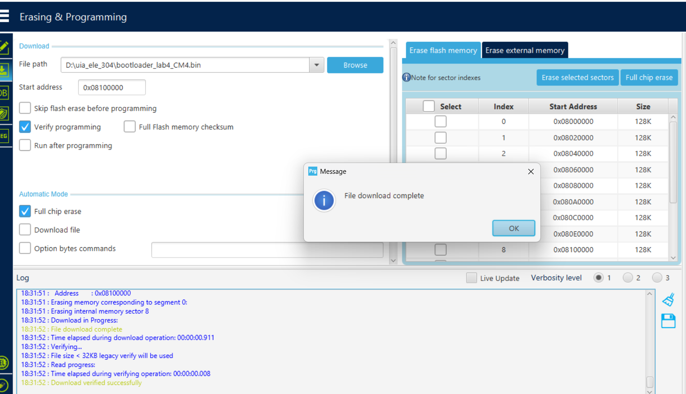
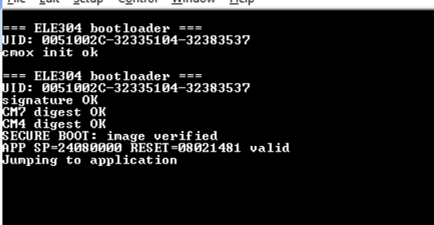
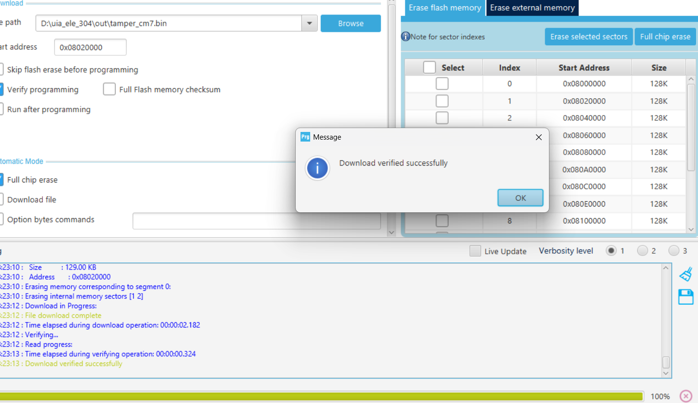
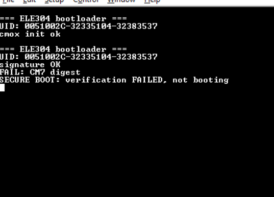
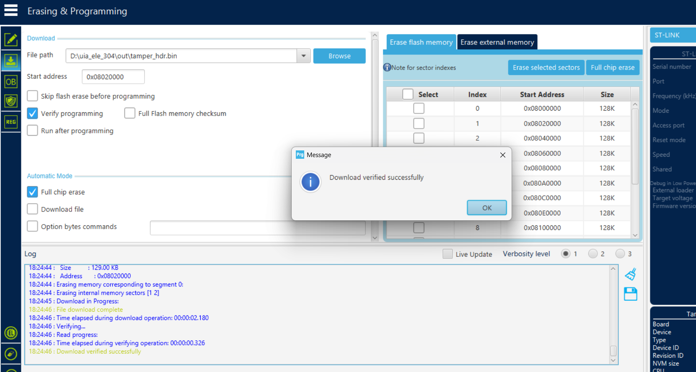
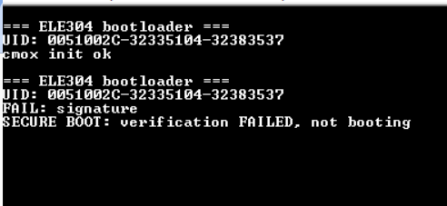
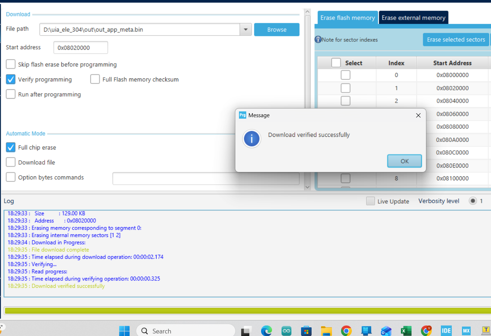
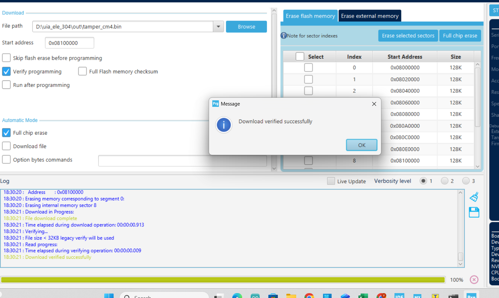
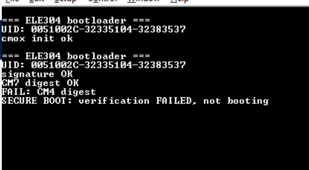

# ELE304 Lab 5: Secure bootloader (STM32H755, CM7 + CM4)

A bootloader at `0x08000000` that verifies an ECDSA (P-256) signature and the
SHA-256 digests of both the CM7 and CM4 application images before it jumps to
the application. If any check fails, it prints the reason on the serial port and
does not boot.

## Lab assignment (summary)

Lab 5 continues Lab 4 (a bootloader that jumps to an application). The lab sheet
asks for a secure bootloader on flash address `0x08000000` that verifies the
signature and compares the digest for the CM4 and CM7 application code:

- **Task 1:** change the Lab 4 bootloader setup so the CM7 application starts at
  `0x08020400` (linker script origin and vector table offset).
- **Task 2 a):** add the code that makes the bootloader secure: verify the
  signed metadata, then the CM7 and CM4 digests, and jump only if everything matches.

The course material this follows (not included in this repository):
*ELE304 LAB 5 Secure bootloader* (lab sheet), *ELE304 Secure Boot Loader*
(lecture, Lab 4 and Lab 5), *ELE304 Secure Boot Loader LAB 5 hint V0.4*, and
*ELE304 Security features* (based on the ST "STM32 security in practice" MOOC).

## Memory map

| Region | Address | Content |
|---|---|---|
| Bootloader (CM7) | `0x08000000` | this project, `CM7/` (one 128 KB sector) |
| Metadata header | `0x08020000` | 0x400 bytes, written by `tools/ele304_postbuild.py` |
| CM7 application | `0x08020400` | linked with `FLASH ORIGIN = 0x08020400`, `VECT_TAB_OFFSET = 0x20400` |
| CM4 application | `0x08100000` | unchanged |

## Metadata header (little-endian)

| Offset | Field |
|---|---|
| 0x00 | magic `0x46574D41` |
| 0x04 | CM7 size |
| 0x08 | CM4 size |
| 0x0C | version |
| 0x10 | SHA-256 of CM7 image (32 B) |
| 0x30 | SHA-256 of CM4 image (32 B) |
| 0x50 | reserved, 48 B (bytes 0x00..0x7F are the signed block) |
| 0x80 | SHA-256 of the signed block (not trusted; the bootloader recomputes it) |
| 0xA0 | ECDSA signature, raw r\|\|s, 64 B |

The same layout is in `CM7/Core/Inc/fwauth.h`.

## Boot flow

1. Check magic and size limits, so no read goes outside the allowed regions.
2. Hash the 128-byte signed block and verify the signature with the public key
   in `ecc_pub_key.h` (`CMOX_ECC_SECP256R1_LOWMEM`).
3. Hash the CM7 image in flash and compare with the signed CM7 digest.
4. Hash the CM4 image and compare with the signed CM4 digest.
5. Jump to the application only if all checks pass.

The private key stays on the PC and only signs. The public key is compiled into
the bootloader as a `const` array, so it lives in flash.

## Build and flash

Dependencies that are not in this repository:
- ST **STM32Cube Expansion Crypto V4.0.0** (`STM32_Cryptographic`). Copy it to
  `CM7/STM32_Cryptographic` and link `libSTM32Cryptographic_CM7.a` (see
  `CM7/.cproject`, whose include and library paths are from the original machine).
  `Core/Src/cmox_low_level.c` is the low-level layer taken from the library template.
- The course's Host_Tools (openssl, `PreBuild.bat`).

Steps:
1. Generate a P-256 key: `openssl ecparam -name prime256v1 -genkey -out ecc.key`.
   **Keep `ecc.key` private and out of git.**
2. Run `PreBuild.bat` to write `ecc_pub_key.h` into `CM7/Core/Inc`, and build the bootloader.
3. Build the CM7 and CM4 applications to `.bin`, then:
   `python tools/ele304_postbuild.py --cm7 app_cm7.bin --cm4 app_cm4.bin --key ecc.key --version 1 --out out --check-header CM7/Core/Inc/ecc_pub_key.h`
4. Flash with STM32CubeProgrammer: bootloader at `0x08000000`,
   `out/out_app_meta.bin` at `0x08020000`, CM4 `.bin` at `0x08100000`.

## Verification on hardware

Each condition was checked on the board: images were flashed with
STM32CubeProgrammer (ST-LINK, "Verify programming" ticked, every download ended with
"Download verified successfully") and the bootloader's output was read on a serial
monitor (Tera Term, COM5, 115200 8N1). Only the signed image may boot; each
modified image must be refused at the check that covers it.

The tampered images were made by flipping one byte (`-bxor 0xFF`) of the good files:

```powershell
# CM7 code: byte at offset 0x500 of out_app_meta.bin
# header:   byte at offset 0x10  of out_app_meta.bin (inside the signed block)
# CM4 code: byte at offset 0x100 of the CM4 .bin
$b = [IO.File]::ReadAllBytes("out_app_meta.bin")
$b[0x500] = $b[0x500] -bxor 0xFF
[IO.File]::WriteAllBytes("tamper_cm7.bin", $b)
```

### Test 1: valid signed image boots

Flashed: `out_app_meta.bin` at `0x08020000` and the original CM4 `.bin` at `0x08100000`.

Result: signature OK, CM7 digest OK, CM4 digest OK, `SECURE BOOT: image verified`,
then the application vector table check and `Jumping to application`.





### Test 2: modified CM7 code is refused

Flashed `tamper_cm7.bin` (one CM7 code byte changed, header untouched) at `0x08020000`.

Result: the signature is still valid, but the CM7 digest no longer matches the
signed hash: `signature OK`, `FAIL: CM7 digest`, `SECURE BOOT: verification FAILED, not booting`.





### Test 3: modified header is refused

Flashed `tamper_hdr.bin` (one byte inside the signed block changed) at `0x08020000`.

Result: the signature does not verify: `FAIL: signature`, not booting. An attacker
cannot edit the stored hashes to match modified code, because the signature covers them.





### Test 4: modified CM4 code is refused

First the good `out_app_meta.bin` was flashed again at `0x08020000`, then
`tamper_cm4.bin` (one CM4 code byte changed) at `0x08100000`.

Result: `signature OK`, `CM7 digest OK`, `FAIL: CM4 digest`, not booting.







### Summary

| Condition | Flashed | Serial output | Booted |
|---|---|---|---|
| Valid signed image | `out_app_meta.bin` + CM4 `.bin` | signature OK, CM7 OK, CM4 OK, verified | yes |
| CM7 code modified | `tamper_cm7.bin` | signature OK, `FAIL: CM7 digest` | no |
| Signed header modified | `tamper_hdr.bin` | `FAIL: signature` | no |
| CM4 code modified | `tamper_cm4.bin` | signature OK, CM7 OK, `FAIL: CM4 digest` | no |

### Not tested on the board

- A valid-format image signed with a different key (the signature check is expected to reject it).
- The magic and size sanity checks.
- The version field is stored and signed, but there is no rollback check.

## Limitations

- The bootloader itself is not write-protected (no WRP/RDP in this lab), so the
  bootloader or the public key could be overwritten with debug access.
- The CM4 may start before verification finishes, depending on boot
  configuration and the D2 domain clock. Not verified on this board.
- The screenshots show this board's chip unique ID in the serial output.
